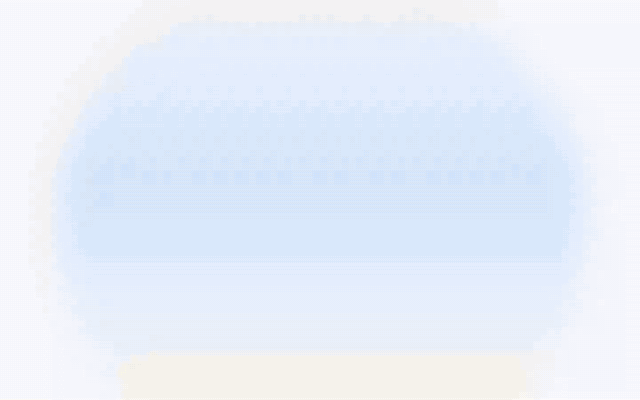

# Oitava

Website statis untuk **Oitava**, brand fiktif yang menjual kepemilikan bersama rumah liburan di Portugal. "Oitava" berarti seperdelapan: satu rumah dibeli, diperabot, lalu dibagi ke delapan pemilik yang masing-masing memegang 1/8 terdaftar, menginap sekitar enam minggu per tahun, dan menanggung biaya bersama. Sasarannya orang yang ingin rumah kedua tanpa membayar sepuluh bulan rumah kosong.

Situs ini adalah rebuild orisinal yang mengikuti struktur, ukuran, dan perilaku sebuah situs referensi real estate. Konsep produk, copy, logo, palet warna, gambar, peta, dan seluruh kode ditulis atau dibuat baru. Nuansa gelap pada referensi diganti menjadi putih, biru kobalt, dan kuning lemon.

## Halaman

| File | Isi |
| --- | --- |
| `index.html` | Home: hero video + pencarian, pernyataan, angka, rel rumah, empat destinasi, pendiri, ajakan |
| `homes.html` | Pencarian rumah dengan filter, urutan, paginasi, dan simpan |
| `collection.html` | Satu rumah unggulan + 10 rumah yang sudah dimiliki penuh |
| `own.html` | Cara memiliki 1/8, form pencarian, contoh rumah |
| `list.html` | Menawarkan rumah, form estimasi tiga langkah |
| `exchange.html` | Tukar minggu antar pemilik, contoh, langkah, form |
| `about.html` | Cerita, tim, linimasa |
| `connect.html` | Kontak |
| `destinations/*.html` (4) | Panduan Comporta, Ericeira, Tavira, Douro: peta interaktif, tempat, rumah setempat |
| `homes/*.html` (34) | Detail tiap rumah: 24 masih ada bagian terbuka, 10 sudah penuh |
| `legal/*.html` (4) | Privasi, syarat, aksesibilitas, fair ownership |
| `404.html` | Halaman tidak ditemukan |

## Fitur dan interaksi

- **Intro** sekali per kunjungan (orb langit ke lemon, cincin berputar, kilau pada nama). Klik untuk melewati.
- **Cincin delapan segmen** terbang dari hero ke bagian pernyataan saat digulir, sambil berubah dari emblem menjadi dekorasi. Versi mininya di kartu menunjukkan berapa bagian yang sudah terisi.
- **Hero video steady**: lima foto dengan dorongan sub-piksel sangat pelan dan crossfade, loop 23 detik. Jeda otomatis saat tidak terlihat.
- **Header** transparan lalu solid, mega menu Destinations, drawer dengan submenu, tombol "Let's Talk" yang muncul setelah digulir.
- **Pencarian lokasi** dengan saran berkelompok, keyboard, dan tidak peka aksen ("Pinhao" menemukan "Pinhão").
- **Filter rumah** (bagian, kamar, tipe, status, urutan), state kosong, paginasi, dan parameter URL (`homes.html?q=Tavira&status=all`).
- **Kartu registrasi** saat menyimpan rumah atau membuka detail. Opsi lewati muncul setelah 5 detik. Tambahkan `?preview` pada alamat detail untuk membukanya tanpa kartu.
- **Lightbox** (panah, Escape, swipe), accordion detail, panel lengket, bar aksi di HP.
- **Peta ilustrasi** SVG: geser, zoom, tab area, chip kategori, pin, kartu tempat, modal "Ask Inês".
- **Form estimasi** tiga langkah dengan validasi. Semua form hanya menampilkan konfirmasi, tidak mengirim data.
- Angka menghitung naik, reveal saat digulir, latar tetap pada ajakan akhir.
- Responsif desktop dan HP, navigasi keyboard, dan `prefers-reduced-motion`. Tidak ada sound.

## Teknologi

HTML, CSS, dan JavaScript native. Tanpa framework, tanpa build, tanpa server. Font Montserrat disimpan lokal.

## Menjalankan

Buka `index.html` langsung di browser. Tautan "Directions" pada peta membuka Google Maps, jadi butuh internet. Sisanya jalan offline.

## Struktur folder

```
.
├── index.html  homes.html  collection.html  own.html  list.html
├── exchange.html  about.html  connect.html  404.html
├── favicon.svg
├── README.md
├── css/style.css
├── js/
│   ├── main.js        perilaku situs
│   └── places.js      daftar destinasi dan desa untuk pencarian
├── destinations/      comporta, ericeira, tavira, douro
├── homes/             34 halaman detail
├── legal/             4 halaman
├── assets/
│   ├── fonts/         Montserrat (normal, italic)
│   ├── img/           foto, potret, SVG cincin
│   └── video/         hero.mp4, hero-mobile.mp4
└── docs/preview/      homepage.gif, hero.png
```

## Mengedit

Semua diedit langsung di file. Tidak ada generator atau langkah build.

- **Warna**: variabel `:root` di awal `css/style.css` (`--ink`, `--cobalt`, `--lemon`, `--mist`, `--sky`). Warna cincin ada di `assets/img/ring*.svg` dan `favicon.svg`. Beberapa bayangan dan garis memakai nilai rgba dari warna yang sama, jadi cari `29,78,216` dan `18,36,90` bila mengganti palet total.
- **Teks**: langsung di HTML. Header, drawer, dan footer ada di setiap halaman, jadi ubah dengan cari dan ganti di seluruh folder.
- **Rumah**: kartu di `homes.html` memuat atribut `data-price`, `data-beds`, `data-left`, dan seterusnya yang dipakai filter. Kartu yang sama juga tampil di home, koleksi, destinasi, dan halaman detail.
- **Tempat di peta**: objek `window.OITAVA_GUIDE` di bagian bawah tiap halaman destinasi (koordinat pada kanvas 1400 x 800).
- **Gambar**: timpa file di `assets/img/` dengan nama yang sama. `hero-1..12` 16:9, `com/eri/eri2/tav/dou/int/split-*` 4:3, `team-*` 3:4.
- **Form**: sambungkan elemen `form[data-done]` ke layanan Anda di `js/main.js`.

## Placeholder yang perlu diganti

Nama brand dan logo, Inês Quental, Tomás, dan Rita, alamat Rua do Limoeiro Azul 8, telepon +351 210 000 888, hello@oitava.example, nomor AMI dan NIPC, angka statistik (9+ tahun, 34 rumah, €48M+), nama dan harga rumah, biaya bulanan, teks legal, serta tautan Instagram dan Facebook (masih `#`). Nama tempat di Portugal nyata, tetapi angka jarak dan catatan wisata perlu diperiksa sebelum tayang.

## Kredit aset

- **Gambar**: dihasilkan AI (Nano Banana via Google Flow). Orang dan rumah di dalamnya fiktif. Foto interior dipakai bersama oleh beberapa rumah dalam satu destinasi.
- **Video hero**: dirakit dari gambar yang sama dengan ffmpeg. Tidak memakai video stok.
- **Font**: Montserrat, SIL Open Font License, dari Google Fonts.
- **Ikon, cincin, dan peta**: digambar sendiri sebagai SVG.

## Catatan keterbatasan

- Peta referensi memakai ubin peta sungguhan. Di sini peta adalah ilustrasi SVG bergaya, tidak sesuai skala.
- Video hero berisi foto bergerak pelan, bukan rekaman drone.
- Latar gelap pada referensi menjadi terang, sehingga urutan kontras tiap section ikut menyesuaikan. Grid, ukuran, tipografi, dan timing mengikuti hasil ukur.
- Referensi memuat ribuan listing dari basis data. Di sini ada 34 rumah statis, dan kartu registrasi hanya menyimpan status di sesi browser.
